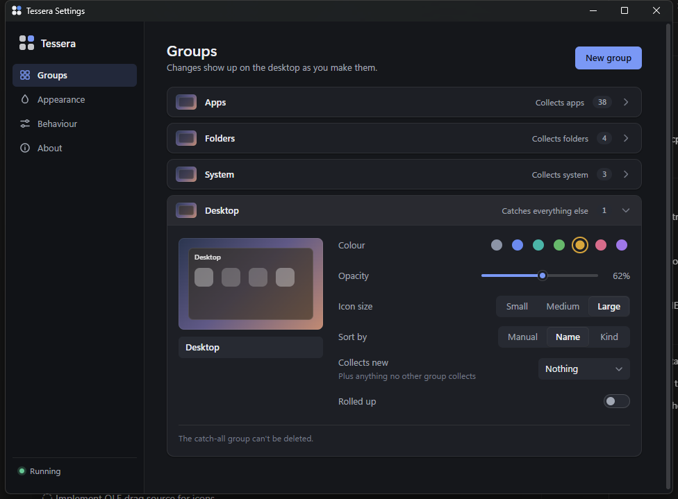
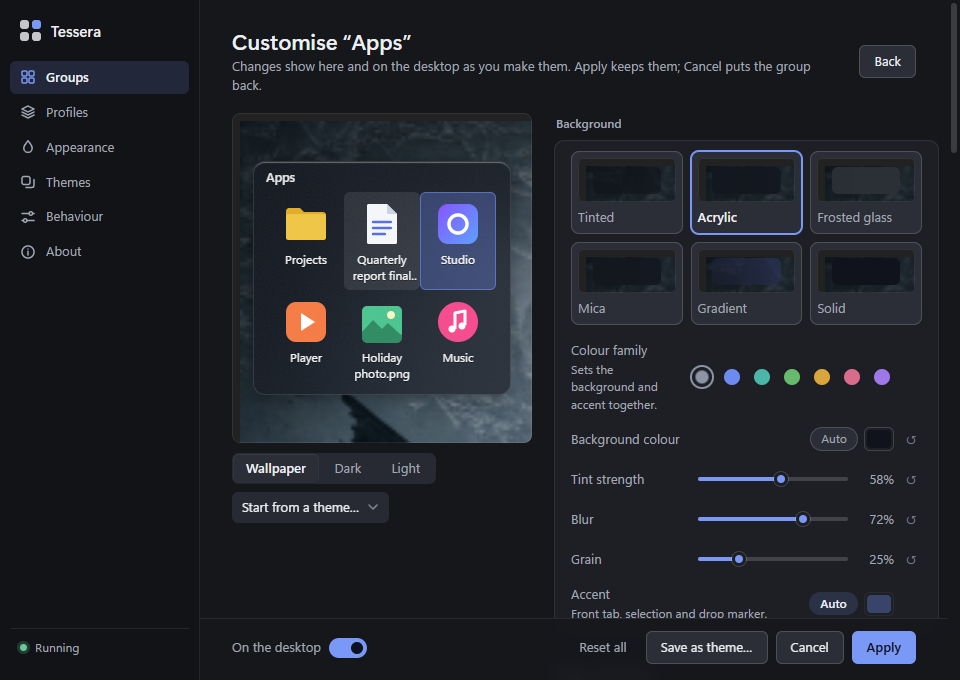

# Tessera

Desktop icon groups for Windows 10/11. A small native Rust program that sorts your desktop icons into quiet, translucent groups — without moving your files, without touching Explorer's own layout, and without running inside Explorer.

Made by **Hashan Kannangara**, Senior Software Engineer, Sri Lanka. Free and open source under the [MIT License](LICENSE).

Website: https://hashank.github.io/Tessera/

> ### ⭐ Add your tile to the mosaic
> A *tessera* is one small tile in a mosaic, and every GitHub star is another tile in this one.
> If Tessera made your desktop calmer, **[give it a star](https://github.com/hashanK/Tessera)**: it takes one click, helps other people find it, and tells me it's worth building the next feature.

## Install

Run `tessera-setup.exe`: download it from the [website](https://hashank.github.io/Tessera/) or the [latest release](https://github.com/hashanK/Tessera/releases/latest), or build it with the command below (it lands in `dist\`). Pushing a version tag such as `v0.1.0` builds and publishes a release automatically (`.github/workflows/release.yml`). It installs for your account only (no administrator prompt) into `%LOCALAPPDATA%\Programs\Tessera`, adds Start menu entries for Tessera and Tessera Settings, and lists Tessera in Settings → Apps so it can be uninstalled from there. A tick box decides whether it starts when you sign in. Uninstalling keeps your groups unless you tick "Also delete my groups, profiles and settings".

To build the installer yourself:

```
powershell -ExecutionPolicy Bypass -File scripts\package.ps1
```

For scripted installs: `tessera-setup.exe --silent [--autostart]` and `uninstall.exe --uninstall --silent`.

The installer isn't code-signed, so Windows SmartScreen may show "Windows protected your PC" the first time; choose **More info → Run anyway**.

## Run from source

```
cargo build --release
target\release\tessera.exe
```

This builds two programs that must sit in the same folder: `tessera.exe` (the organiser) and `tessera-settings.exe` (the settings window, started from the tray icon and gone from memory when closed).

- Exit from the tray icon. Explorer's own icons come back exactly as they were.
- `tessera.exe --quit` closes a running instance cleanly; `tessera.exe --restore` brings Explorer's icons back if the process was killed.
- Data lives in `%APPDATA%\Tessera\layout.json`. Put an empty file named `tessera.portable` next to the exe to keep data in `.\data` instead.

## Using it

| Do this | To |
|---|---|
| Drag a title bar | Move a group (snaps to screen edges and other groups) |
| Drag an edge, or just inside a corner | Resize |
| Double-click a title bar | Roll up / expand |
| Right-click a title bar or empty area | Rename, sort, icon size, colour, opacity, fit, new group, settings, delete |
| Settings → Groups → a group → Customise…, or Settings → Themes | Give a group its own look: material (tinted, acrylic, frosted glass, Mica, gradient, solid), border, shadow, title bar, font and label style, icon effects, hover and selection motion, and spacing, with a live preview. Save looks as themes, apply a theme to one group or all of them, import and export themes as JSON |
| Settings → Themes → From your wallpaper | See your wallpaper's six main colours (largest first) and give every group, or new groups, one of them as its background, with a matching accent if you like. The appearance editor offers the same colours as quick picks. **Follow my wallpaper** recolours every group automatically whenever you change the wallpaper |
| Open Tessera again (Start menu) while it is running, or Tessera Settings, or double-click the tray icon | Open the settings window |
| Drag an icon | Move it to another group or reorder it — or drag it out to Explorer, the Recycle Bin or any program that accepts files |
| Drop files from Explorer or another program onto a group | Bring them to the Desktop and file them in that group (move within a drive, copy across drives; Ctrl copies, Shift moves) |
| Drop a link from a browser onto a group | Create an Internet shortcut on the Desktop, filed in that group |
| Drop onto a folder or the Recycle Bin inside a group | Same as on the native desktop: move into the folder, or delete. Aim at the middle of the icon; the gaps between icons reorder |
| Double-click / right-click an icon | Open it / the real Explorer context menu |
| Ctrl+click, Shift+click, Ctrl+Shift+click; Ctrl+A; Shift+arrows | Select several icons in a group (toggle, range, add a range; all; extend). Dragging, deleting, copying, cutting, opening, the right-click menu and Alt+Enter then act on all of them |
| Keyboard, while the desktop is the active window (click an icon or the desktop) | Arrow keys, Home, End, Page Up/Down move between icons and on to the next group; typing jumps to an icon by name; Enter opens; F2 renames the file; Delete / Shift+Delete delete it (Recycle Bin / permanently); Ctrl+C, Ctrl+X, Ctrl+V copy, cut and paste files (pasted files land in the selected group); Ctrl+Shift+N makes a new folder in the group and starts renaming it; Alt+Enter shows Properties; Shift+F10 or the Menu key opens the right-click menu; F5 refreshes; Esc deselects |
| Mouse wheel | Scroll a group that overflows |
| Tray icon → New folder portal… (or a group's right-click menu, or Settings) | Add a group that shows a folder's contents live. Double-click a subfolder to browse into it; the ‹ in the title goes back |
| Right-click a group → Tabs → Add tab, or Combine into another group | Turn a group into tabs (like *Math · Science · History*). Click a tab to switch; drag an icon onto a tab's name to file it there |
| Tray icon → Profiles, or Ctrl+Alt+Shift+1…9 | Switch between complete desktop arrangements; "New profile" copies the current one |
| Ctrl+Alt+H | Hide or show all groups |
| Ctrl+Alt+Space | Peek: float groups above all windows |
| Tray icon | Double-click for settings; right-click for new group, hide, peek, light theme, rebuild groups, settings, exit |

## Settings window





Groups (name, look, colour, opacity, icon size, sort, which kind of new item a group collects, roll-up, delete), an appearance editor per group, a theme library, appearance (light or dark, low effects, look for new groups, apply to all), behaviour (start with Windows, shortcuts, rebuild) and about (data folder, quit). It needs the WebView2 runtime, which Windows 11 includes.

The window never edits the layout file. It sends commands to the organiser, which applies them, saves, and is read back. The same commands work from a script:

```
tessera-settings.exe --send "{\"cmd\":\"theme\",\"value\":\"Light\"}"
```

Exit code 0 means the organiser accepted the command. Commands: `theme`, `fence`, `look`, `look_defaults`, `look_all`, `theme_save`, `theme_rename`, `theme_delete`, `effects`, `rule`, `defaults`, `apply_all`, `new_group`, `new_portal`, `delete`, `rebuild`, `profile_new`, `profile_switch`, `profile_rename`, `profile_delete`, `peek`, `hidden`, `quit` — see [crates/core/src/ipc.rs](crates/core/src/ipc.rs).

## Status

Checked by driving the real app on Windows 11 build 26300 with synthetic mouse and keyboard input and reading screenshots; logic in `tessera-core` is unit-tested (22 tests).

| Feature | State |
|---|---|
| First-run grouping by kind | Verified |
| Render groups, icons, two-line labels | Verified |
| Move, resize, roll up, rename | Verified |
| Drag icon between groups (now through OLE drag and drop) | Verified |
| Drop a file from an Explorer window onto a group: moved to the Desktop and filed in that group | Verified |
| Drop across drives copies; Shift forces a move; Ctrl forces a copy; two files at once | Verified |
| Name conflict: Explorer's replace/skip dialog appears; Replace works and the file is filed in the group | Verified ("keep both" not exercised) |
| Drop a file onto a folder icon inside a group: goes into that folder | Verified |
| Drag an icon onto the Recycle Bin icon inside a group: deleted | Verified |
| Drop a browser-style link: an Internet shortcut is created and filed in the group | Verified with a test drag source that offers the same data formats as a browser; not with a real browser |
| Drag an icon out of a group into an Explorer folder: file moved there, icon leaves the group | Verified |
| Reorder within a group through OLE; drag image and copy cursor | Verified |
| Insertion marker and drop-onto highlight while dragging | Implemented, not looked at closely |
| Native shell context menu on items | Verified (menu appears; commands not individually exercised) |
| Group menu, colour change | Verified |
| Layout persists across restarts | Verified |
| New, renamed, deleted desktop files picked up automatically | Verified |
| Groups stay visible in Show Desktop (Win+D), behind apps otherwise | Verified |
| Peek hotkey | Verified |
| Clean exit restores Explorer's icons; `--restore` after a hard kill | Verified |
| Zero CPU while idle | Verified (0.0 ms over 15 s) |
| Selection clears when you click the bare desktop, another program, an empty spot or a title bar (as on the native desktop) | Verified |
| Delete key sends the selected item to the Recycle Bin; ignored while another program is active; clicking an icon makes the desktop active | Verified (on a test folder) |
| Groups appear when Tessera starts while the desktop is in front (Show Desktop) | Verified |
| Keyboard: arrows within a group and across to the next group, Home, End, type-to-find (and repeating a letter to cycle), F2 rename (file renamed, stays in its group), Ctrl+C then Ctrl+V (a \"- Copy\" in the same group), Ctrl+Shift+N (new folder, renamed in place), Alt+Enter, Shift+F10, Esc; keys are refused while another program is active; works when Tessera starts with the desktop already active | Verified (keys sent only after checking the active window; results checked on disk and in a diagnostic log) |
| Keyboard: Page Up/Down, Ctrl+X, Shift+Delete, Enter, F5, the Menu key, paste into a portal | Implemented, not exercised |
| Multi-select: Ctrl+click toggles, Shift+click ranges, Ctrl+Shift+click adds a range, a plain click on a selected icon reduces to it, Ctrl+A, Shift+arrows and Shift+End; dragging two icons into another group together; copy and paste of two folders; deleting five folders at once to the Recycle Bin; the combined right-click menu and Properties sheet; keyboard focus returns to the desktop after an icon menu | Verified (deletes guarded: every selected name checked first) |
| Multi-select: dragging several icons out to Explorer, cutting several, double-clicking a selection to open all | Implemented, not exercised |
| Title bar options: pill or underline title, row tint colour, capitals, item count (on hover / always / never), apply title bar to all groups | Implemented; the apply-to-all command is unit-tested, not yet checked on screen |
| Wallpaper colours: six colours found in a real wallpaper and ranked by share (most prominent 44 %); the Themes section and the editor quick picks (a pick sets the colour, sends nothing) | Verified |
| Wallpaper colours: \"Apply to all groups\" and \"Use for new groups\" on the real desktop | Implemented; the recolour command is unit-tested, not pressed live (it would have recoloured the user's real groups) |
| Materials on the desktop: acrylic, frosted glass, Mica, gradient, solid paper with grain; blurred wallpaper, rounded corners, top highlight | Verified (screenshots) |
| Typography and icon looks on the desktop: another font, letter spacing, labels beside icons, centred bold title, circular icon backgrounds, reduced icon colour | Verified (screenshots) |
| Appearance editor: opens for a group, live preview on the desktop while editing, Cancel restores the group, Apply keeps the look | Verified (driven through the WebView2 DevTools protocol, not by mouse) |
| Themes: apply from a group card, save from the editor, duplicate, rename, delete; a group is recognised as using a theme | Verified (same way) |
| Low effects: wallpaper materials fall back to plain translucency, no grain or shadows | Verified |
| Hover and selection motion on the desktop: Pop hover with glow builds over about 300 ms, frame by frame; Pulse selection ripple; the animation timer stops afterwards (0.0 ms CPU with the pointer resting on an icon) | Verified (pixel sampling of screen captures) |
| Motion choices in the editor, with a preview you can point at and click | Verified (driven through DevTools) |
| Repaint cost with wallpaper material and shadow: 6.5 ms for a 39-icon group; idle CPU still 0.0 ms; 23.9 MB private memory | Measured |
| Theme import and export (file dialogs), hover glow and lift (need a real pointer), shadows on a light wallpaper, wallpaper change and slideshow, display scaling other than 100 % | Implemented, not tested |
| Tabs: combine two groups, add a tab, click a tab to switch, drag an icon onto a tab name, equal-width and fit-to-name styles, tabs survive a restart | Verified |
| Tabs in settings: pick a tab, add and name a tab, make a tab its own group (lands beside the original) | Verified |
| Tabs: move left/right, Combine into… in settings, the Tabs submenu's items, closing a tab, a portal as a tab | Implemented, not exercised (the underlying commands are unit-tested) |
| Profiles: create as a copy, edit independently, switch back, survive a restart, rename, delete, refuse to delete the last one | Verified by command |
| Profiles page and portal card in the settings window | Verified (rendered; buttons not clicked) |
| Profile switching from the tray menu and by Ctrl+Alt+Shift+digit | Implemented, not tested |
| Folder portal: lists a folder (folders first), updates when a file is added, browse into a subfolder and back | Verified |
| Folder portal: drop a file from Explorer in; drag an item out onto a desktop group | Verified (same-drive moves) |
| Folder portal: folder picker, Open in Explorer, links dropped on a portal, network or very large folders, portals across profile switches | Implemented, not tested |
| Settings window: colour, icon size and sort clicked in the UI and applied on the desktop | Verified |
| Settings window: page navigation, not-running banner | Verified |
| Commands from the command line: theme, new group, rename, opacity clamp, delete, quit, invalid command rejected | Verified |
| Settings window: name field, opacity slider, collects-new, roll-up, delete, new group, theme, new-group defaults, apply to all, rebuild, start, open folder, quit buttons | Implemented, not clicked in testing (most of the underlying commands are verified above or unit-tested) |
| Installer: install, Start menu shortcuts, Settings → Apps entry, start-with-Windows value, closing a running copy, uninstall (files, shortcuts, registry removed; layouts kept) — both with dialogs and `--silent` | Verified |
| Installer: update over an older version, "delete my groups" on uninstall, the WebView2-missing warning | Implemented, not tested |
| Start with Windows from the settings toggle | Implemented, not tested (the installer writes the same value, which is verified; signing in again was not) |
| Opening settings by launching Tessera again while it runs (window comes to the front) | Verified |
| "Settings…" in the group menu | Verified the item is shown; opens through the same path as above, not clicked |
| Opening settings from the tray icon | Implemented, not tested |
| Double-click to open an item | Implemented, not exercised in testing |
| Hide hotkey, tray menu, light theme, sort modes, icon sizes, opacity, delete group, fit to contents, scrolling | Implemented, not exercised in testing |
| Explorer-restart recovery, display-change layout restore | Implemented, not tested |
| Multi-monitor, non-100 % DPI | Implemented, not tested (single 1080p monitor available) |

Not built yet: rubber-band (drag a box) selection, a selection spanning several groups, configurable hotkeys, switching profile automatically (by display or running app), dropping plain text or images, dropping onto an app icon to open with it, search, rule editor, Ctrl+Z for operations done through Tessera. See [ROADMAP.md](ROADMAP.md).

## Known limitations

- Dropping files from elsewhere onto a group really moves or copies them to your Desktop folder, exactly as dropping on the desktop would. Ctrl+Z on the desktop does not undo it (Windows keeps undo per program); deleted items are in the Recycle Bin. Rearranging icons between groups never touches files.
- Dropping onto a sorted group switches it to manual order.
- A folder portal acts on real files: dragging something out of it, or dropping something into it, moves or copies the file like an Explorer window would. A portal shows at most 1,000 items and has no manual order.
- In a tabbed group, colour, opacity, icon size, roll-up and tab style belong to the whole group; name, sort order, the kind of new item it collects, and a portal folder belong to each tab.
- Closing the first tab hands the group's window to the next tab; its icons go to the catch-all group like any deleted group.
- Each profile keeps its own grouping. An icon you file into a group in one profile is not moved in the others.
- Don't point a portal at the Desktop folder itself; its items would be listed twice.
- Acrylic, Frosted glass and Mica blur the wallpaper, captured once, not whatever is really behind a group: a group over another group shows the wallpaper, and an animated wallpaper looks frozen. Windows' own blur does not work on this kind of window (see ADR-16). Changing the wallpaper is picked up after about a second; a slideshow change may not be.
- A shadow makes the group's window larger than the group, so the empty desktop right next to a group with a shadow doesn't take clicks.
- Every desktop item lives in a group; there are no free-floating icons. Unassigned items go to **Desktop**.
- Clicks pass through the fully transparent pixels outside a group's rounded corners, so corner resizing has to start a few pixels inside.
- The rename box and menus are stock Win32 controls and do not follow the group theme.
- While Tessera runs, Explorer's icon layer is hidden. If Tessera is killed, run `tessera.exe --restore` or start it again.

## Layout

| Path | What |
|---|---|
| `crates/core` | Model, grid layout, rules, persistence. No OS calls. |
| `crates/app` | Win32 app: shell integration, Direct2D renderer, group windows. |
| `crates/settings` | Settings window: a thin WebView2 host (`src/main.rs`) and one HTML file (`ui/index.html`). |
| `crates/setup` | Installer and uninstaller (`tessera-setup.exe`), carrying the release builds inside it. |
| `build-support/resources.rs` | Embeds the app icon (`assets/tessera.ico`) and version information at build time. |
| `assets` | The app icon: master PNG, multi-size .ico, small PNG for the settings window. |
| `site` | The website (home page and privacy policy), published to GitHub Pages by `.github/workflows/pages.yml`. |
| `scripts/package.ps1` | Builds everything and writes `dist\tessera-setup-<version>.exe`. |
| `spikes/probe` | Feasibility probe used for the Phase 1 measurements. |
| `docs/research.md` | Competitive research and feasibility results. |
| `docs/architecture.md` | Architecture and decision log. |
| `docs/design.md` | MVP definition, journeys, identity and tokens. |
| `docs/store-listing.md` | Text for the Microsoft Store listing. |

## Author and licence

Tessera is made by **Hashan Kannangara**, Senior Software Engineer, Sri Lanka. Project page: https://github.com/hashanK/Tessera

It is free and open source under the [MIT License](LICENSE): anyone may use, copy, change and share it, including commercially, as long as the copyright notice and licence travel with it. See also the [privacy policy](https://hashank.github.io/Tessera/privacy.html).

---

<p align="center">
  <b>Enjoying a tidier desktop?</b><br>
  Every ⭐ is a tile in the mosaic. <a href="https://github.com/hashanK/Tessera">Star Tessera on GitHub</a>, share it with a friend whose desktop needs it, or <a href="https://github.com/hashanK/Tessera/issues">tell me what to build next</a>.
</p>
